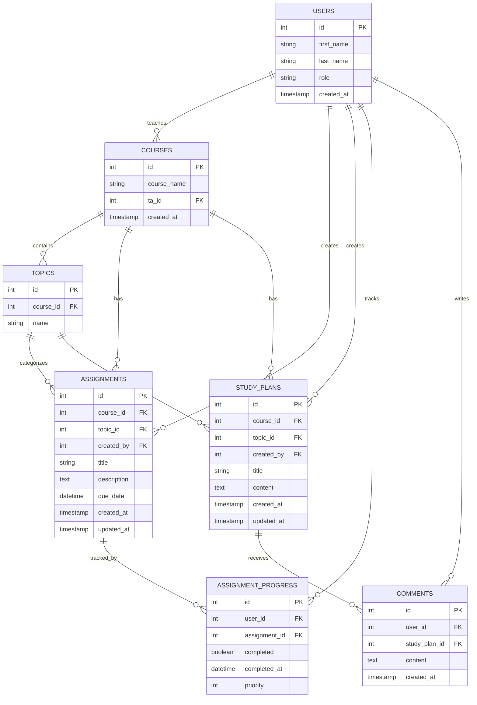

# Entity Relationship Diagram

Reference the Creating an Entity Relationship Diagram final project guide in the course portal for more information about how to complete this deliverable.

## Create the List of Tables

- Users
- Courses
- Topics
- Assignments
- Assignment Progress
- Study Plans
- Comments

## Add the Entity Relationship Diagram

## USERS

| Column Name | Type | Description |
|-------------|------|-------------|
| id | integer | Primary key |
| first_name | text | First name of user |
| last_name | text | Last name of user |
| role | text | User role (`student` or `ta`) |
| created_at | timestamp | Timestamp when user record was created |

## COURSES

| Column Name | Type | Description |
|-------------|------|-------------|
| id | integer | Primary key |
| course_name | text | Name of the course |
| ta_id | integer | Foreign key referencing the TA user responsible for the course |
| created_at | timestamp | Timestamp when course record was created |

## TOPICS

| Column Name | Type | Description |
|-------------|------|-------------|
| id | integer | Primary key |
| course_id | integer | Foreign key referencing the associated course |
| name | text | Name of the topic |

## ASSIGNMENTS

| Column Name | Type | Description |
|-------------|------|-------------|
| id | integer | Primary key |
| course_id | integer | Foreign key referencing the associated course |
| topic_id | integer | Foreign key referencing the associated topic |
| created_by | integer | Foreign key referencing the user who created the assignment |
| title | text | Assignment title |
| description | text | Detailed assignment description |
| due_date | datetime | Assignment due date and time |
| created_at | timestamp | Timestamp when assignment was created |
| updated_at | timestamp | Timestamp when assignment was last modified |

## ASSIGNMENT_PROGRESS

| Column Name | Type | Description |
|-------------|------|-------------|
| id | integer | Primary key |
| user_id | integer | Foreign key referencing the user tracking progress |
| assignment_id | integer | Foreign key referencing the assignment |
| completed | boolean | Indicates whether the assignment has been completed |
| completed_at | datetime | Date and time the assignment was completed |
| priority | integer | User-assigned priority level for the assignment |

## STUDY_PLANS

| Column Name | Type | Description |
|-------------|------|-------------|
| id | integer | Primary key |
| course_id | integer | Foreign key referencing the associated course |
| topic_id | integer | Foreign key referencing the associated topic |
| created_by | integer | Foreign key referencing the user who created the study plan |
| title | text | Study plan title |
| content | text | Study plan content and recommendations |
| created_at | timestamp | Timestamp when study plan was created |
| updated_at | timestamp | Timestamp when study plan was last modified |

## COMMENTS

| Column Name | Type | Description |
|-------------|------|-------------|
| id | integer | Primary key |
| user_id | integer | Foreign key referencing the user who wrote the comment |
| study_plan_id | integer | Foreign key referencing the study plan being commented on |
| content | text | Comment text |
| created_at | timestamp | Timestamp when comment was created |
